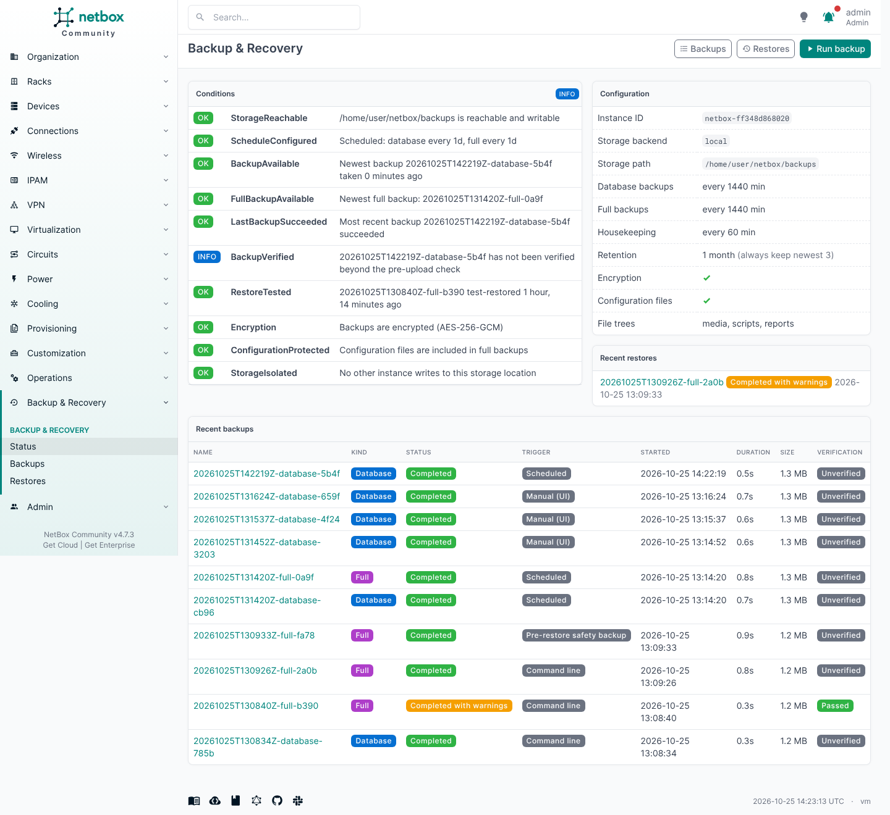
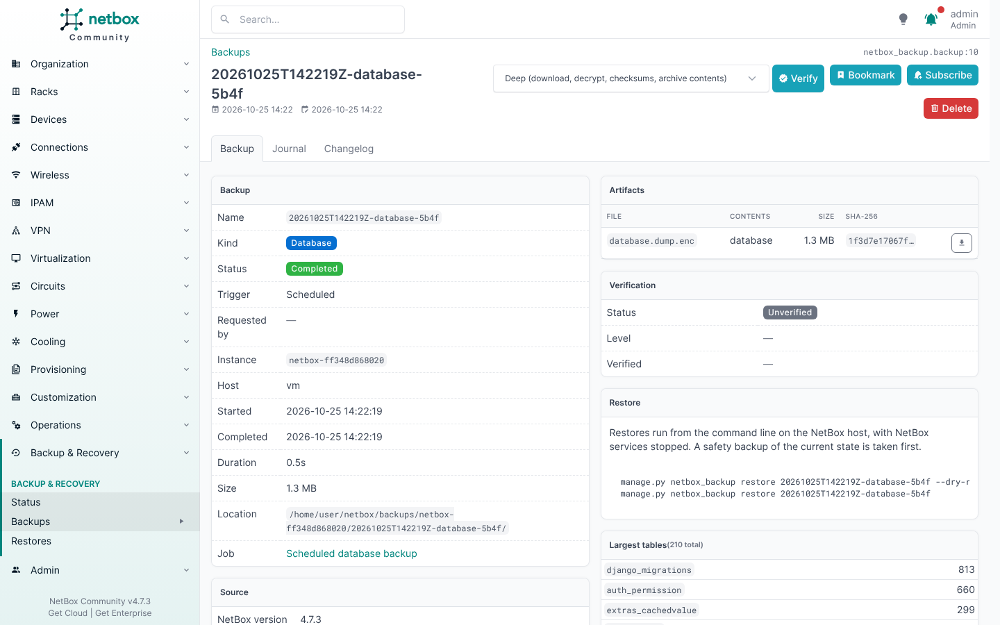
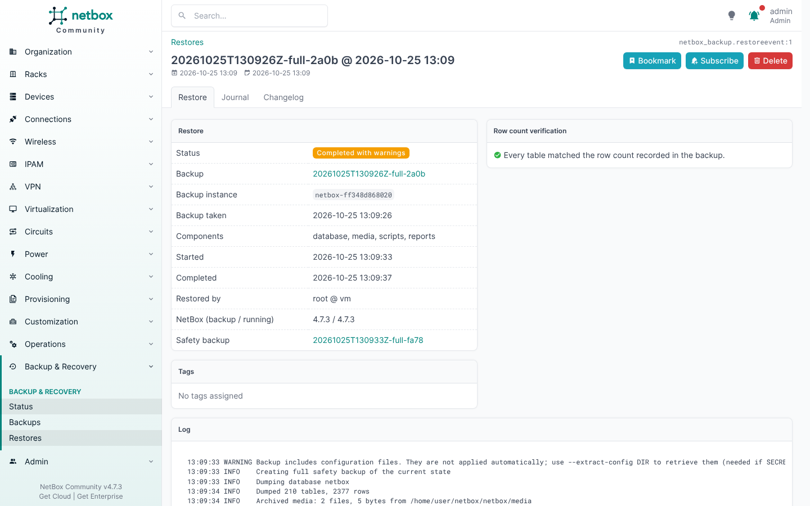
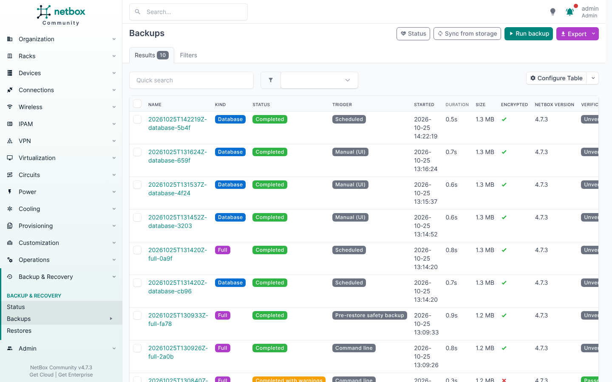

# netbox-backup

Open-source backup, verification and disaster recovery for [NetBox](https://github.com/netbox-community/netbox).

NetBox Enterprise ships disaster-recovery backups, scheduled PostgreSQL backups, retention policies, restore
safeguards and health conditions. Community installs usually get a cron job running `pg_dump`. This plugin
brings the same operating model to any NetBox install: bare metal, Docker or Kubernetes.

| | |
|---|---|
| **Backs up** | PostgreSQL database (consistent snapshot), media, scripts, reports, configuration files |
| **Stores to** | Local directory / NFS mount, or any S3-compatible bucket (AWS, MinIO, Ceph, Wasabi, B2, …) |
| **Schedules** | Database backups daily (on by default), full backups on their own interval (off by default) |
| **Retention** | Age-based (default *1 month*), and always keeps the newest *N* successful backups |
| **Encryption** | Optional AES-256-GCM per artifact; the key is never stored with the backup |
| **Verifies** | Every backup before upload; on demand *quick*, *deep*, or a **test restore** into a scratch database |
| **Restores** | One command, with preflight checks, an automatic safety backup and row-count verification |
| **Reports** | Health conditions in the UI, REST API and CLI (`status` exits 0/1/2 for monitoring) |

Tested with NetBox 4.4 and 4.7. Requires NetBox 4.4 or later, PostgreSQL client tools (`pg_dump`/`pg_restore`, at least the server's major
version) on the NetBox host, and a running `netbox-rq` worker for scheduled backups.

## Quick start

```bash
source /opt/netbox/venv/bin/activate
pip install "netbox-backup[all]"        # [s3] for boto3, [encryption] for cryptography
```

`configuration.py`:

```python
PLUGINS = ['netbox_backup']

PLUGINS_CONFIG = {
    'netbox_backup': {
        'storage': {
            'backend': 's3',
            'bucket': 'netbox-backups',
            'prefix': 'prod',
            'region_name': 'eu-central-1',
            'access_key_id': '...',
            'secret_access_key': '...',
        },
        'encryption_key': '...',          # manage.py netbox_backup genkey; store it OUTSIDE NetBox too
        'full_backup_interval': 1440,     # daily full backup (minutes)
    },
}
```

```bash
cd /opt/netbox/netbox
python manage.py migrate
sudo systemctl restart netbox netbox-rq

python manage.py netbox_backup create --full --verify restore   # first backup, proven restorable
python manage.py netbox_backup status
```

Then open **Backup & Recovery → Status** in the NetBox UI.



<details><summary>More screenshots</summary>





</details>

## Restoring

```bash
sudo systemctl stop netbox netbox-rq
python manage.py netbox_backup restore latest-full --dry-run    # preflight only, changes nothing
python manage.py netbox_backup restore latest-full              # asks you to type the backup name
sudo systemctl start netbox netbox-rq
```

The restore refuses a backup from a different instance, a backup made by newer NetBox code, or a backup encrypted
with a different key. It also refuses while other sessions are connected to the database. It takes a safety backup
first, and verifies every table's row count against the manifest afterwards. Restores run from the CLI only,
because they replace the database the web UI runs on.

## Documentation

* [Backup Essentials](docs/backup-essentials.md): set it up once, check it, restore onto a new host
* [Backup and Restore in Depth](docs/backup-and-restore.md): artifacts, manifest, verification, restore internals
* [PostgreSQL Disaster Recovery](docs/postgresql-dr.md): logical backups vs. PITR, pairing with pgBackRest
* [Configuration reference](docs/configuration.md)
* [REST API & CLI reference](docs/reference.md)
* [Troubleshooting](docs/troubleshooting.md)
* [Enterprise feature parity](docs/enterprise-parity.md): how this plugin maps to NetBox Enterprise backups

## Development

```bash
git clone https://github.com/netbox-community/netbox.git && cd netbox && pip install -r requirements.txt
pip install -e /path/to/netbox-backup[all] moto
cd netbox
PYTHONPATH=/path/to/netbox-backup/testing NETBOX_CONFIGURATION=netbox_backup_testing \
    python manage.py test netbox_backup
```

The suite runs real `pg_dump`/`pg_restore` round trips against the test database. S3 is tested with `moto`.

## License

Apache 2.0
